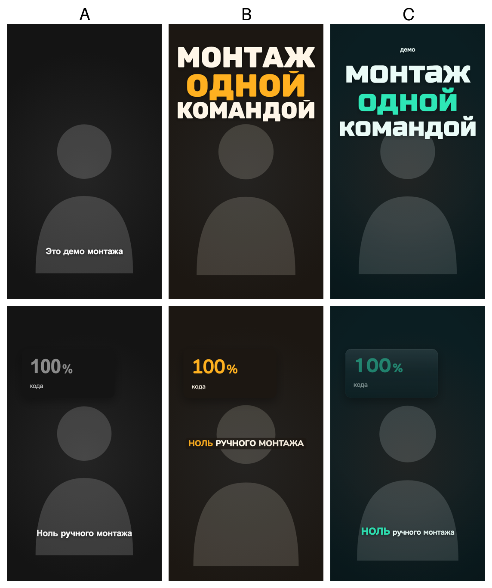

# Монтаж рилсов с Claude Code

Шаблон от [DA||AI](https://delaiai.ru): Claude Code монтирует вертикальные ролики «говорящая голова» для Reels, TikTok и Shorts и сам выкладывает их в Instagram.

Ты снимаешь дубль на телефон, кладёшь файл в папку и пишешь «смонтируй». Claude Code:

- вырезает паузы, повторы и оговорки, порядок твоих фраз не трогает;
- проверяет каждую склейку отдельно, чтобы на стыке не осталось повторённого слова;
- расшифровывает речь и ставит субтитры;
- добавляет заголовок за головой, карточки с цифрами, стикеры и звуки, если ты их выбрал;
- сводит громкость под ленту, голос оставляет как записан, без шумодава;
- рендерит готовое видео и обложку;
- по команде «опубликуй» кладёт ролик в Dropbox и ставит пост в Buffer, откуда он выходит в Instagram в назначенное время.

Своего стиля у шаблона нет. При первом запуске Claude Code расспросит тебя, попросит ссылки на рилсы, которые нравятся, и соберёт стиль из ответов. Цвета, шрифты и вид субтитров он показывает готовыми кадрами, выбираешь глазами.



<sub>Один демо-ролик: A до настройки, B и C с двумя разными настройками. Вместо лица заглушка.</sub>

## Как начать

**Одной фразой.** Открой Claude Code (терминал или приложение) в папке, где будут лежать ролики, и напиши:

```
Склонируй https://github.com/denislysenko/delai-reels, прочитай CLAUDE.md и настрой монтаж под меня
```

Claude Code склонирует проект, проверит, что стоит на компьютере, проведёт интервью и всё настроит. В конце попросит перезапустить его в папке проекта.

**Вручную.**

```bash
git clone https://github.com/denislysenko/delai-reels
```

```bash
cd delai-reels && claude
```

Напиши что угодно, например «привет». Проект увидит, что ещё не настроен, и Claude Code начнёт интервью сам. Или набери `/setup`.

Видео весят много. Если на компьютере мало места, клонируй проект сразу на внешний диск и держи там же сырые дубли.

## Что спросит Claude Code при первом запуске

По одному блоку за раз. Любой можно пропустить и вернуться к нему позже.

1. **Кто ты.** Бренд или имя, о чём ролики, площадки и аккаунты, аудитория, тон, язык, финальный призыв.
2. **Около 10 рилсов, которые нравятся.** Просто ссылки на Instagram, TikTok или Shorts. Claude Code скачает их, измерит темп склеек, первые секунды, громкость, скорость речи, посмотрит раскадровки и расскажет, что у них общего. Это твой «профиль вкуса», из него дальше строятся варианты.
3. **Как снимаешь.** Телефон или камера, микрофон, комната, свет. Если уже есть снятый дубль, Claude Code сам померит картинку и звук и подскажет пару вещей, которые заметно улучшат запись.
4. **Расшифровка речи.** Бесплатно на своём компьютере (whisper.cpp) или через ElevenLabs.
5. **Сервисы.** ElevenLabs, Higgsfield, 21st.dev и выкладка в Instagram, по очереди: что каждый даст и сколько стоит. Нужные Claude Code проведёт через регистрацию и проверит, что доступ работает. Подробно в [SERVICES.md](SERVICES.md).
6. **Что тебе нравится.** Разбор твоих референсов: что берём к себе, что нет.
7. **Палитра.** Фирменные цвета (код цвета, сайт или логотип), что выделять, чего избегать. Два-три варианта готовыми кадрами.
8. **Шрифты.** Фирменные или по характеру. Claude Code подберёт свободные шрифты с кириллицей, похожие на те, что в референсах.
9. **Вид монтажа.** Субтитры, графика, движение, звук. По каждой теме варианты кадрами.

Технику не спрашивает: зоны под интерфейс соцсетей, нарезку без обрезанных слов и сведение громкости проект делает сам. В конце покажет демо-кадры со всеми твоими решениями.

## Один ролик

Положи дубль в `takes/` и напиши «смонтируй takes/1.MOV». Дальше так:

1. Claude Code ищет повторы и фальш-старты и показывает список, что вырежет. Режет после твоего «да».
2. Режет паузы. Склейки становятся ритмом ролика.
3. Проверяет каждый стык отдельно: расшифровывает пару секунд вокруг него и показывает кадры до и после. Так ловятся повторённые слова и моменты, где ты тянешься к камере.
4. Правит расшифровку, расставляет акценты по смыслу, собирает список карточек и стикеров.
5. Показывает ключевые кадры. Готовое видео рендерит только после твоего «ок».
6. Делает обложку и складывает монтаж в архив `edits/`.

Правки после готового видео («вырежи эту фразу») делаются на готовом файле, без пересборки всего ролика.

## Выкладка в Instagram

Напиши «опубликуй» или «поставь на завтра в 10:00». Claude Code напишет подпись под твой тон, покажет её, а после твоего «да» поставит пост в Buffer.

Почему нужны два сервиса. Buffer публикует в Instagram и держит расписание, но файлы не принимает: ролик он скачивает по ссылке в момент публикации. Ссылка нужна публичная и прямая, без страницы просмотра. Такую даёт Dropbox: Claude Code кладёт туда ролик через отдельное приложение, которое видит только свою папку, а после выхода поста удаляет файл.

Что понадобится один раз, примерно 15 минут:

- Instagram в режиме профессионального аккаунта («Автор» или «Бизнес»), подключённый в Buffer;
- ключ API Buffer;
- приложение Dropbox с доступом только к своей папке и один вход по ссылке.

Пошагово в [SERVICES.md](SERVICES.md) → «Instagram: Buffer + Dropbox». Ничего не уходит в публикацию без твоего «да» на конкретный пост и время.

## Сервисы

Все по желанию. Без них монтаж работает: локальная расшифровка, ролик без звуковых акцентов или с твоими звуками, публикация руками.

| сервис | что даёт | доступ |
|---|---|---|
| [ElevenLabs](https://elevenlabs.io) | расшифровка с таймкодами (Scribe), звуки, озвучка | ключ в `video/.env` |
| [Higgsfield](https://higgsfield.ai) | короткие видеовставки и картинки | вход через браузер |
| [21st.dev](https://21st.dev) | готовые компоненты для графики | ключ в `video/.env` |
| [Buffer](https://buffer.com) | публикация и расписание в Instagram, TikTok, YouTube | ключ в `video/.env` |
| [Dropbox](https://www.dropbox.com/developers/apps) | прямая ссылка на ролик для Buffer | приложение и вход, ключи в `video/.env` |

Ключи ты вписываешь сам в `video/.env`, этот файл не попадает в git. В чат ключи не присылай: Claude Code их не просит и не печатает, только проверяет, что они работают («проверь доступ»). Платные генерации запускаются только с твоего согласия и с названной ценой.

## Что нужно на компьютере

- macOS (проверено на Apple Silicon). Linux должен работать, Windows через WSL.
- [Claude Code](https://docs.claude.com/en/docs/claude-code), Node.js 18+, ffmpeg, Python 3.
- whisper.cpp с моделью (около 1,6 ГБ) или ключ ElevenLabs.
- Для заголовка за головой: rembg (модель около 1 ГБ, на ролик примерно полчаса фоном).

Чего не хватает, Claude Code предложит поставить сам и сначала скажет, что ставит и сколько это весит. Проверка в любой момент: `bash video/scripts/doctor.sh`.

## Как снимать, чтобы монтаж получился лучше

- Снимай в 4K, если телефон умеет: на склейках кадр увеличивается, и запас разрешения держит резкость.
- Свет спереди на лицо. Окно или лампа за камерой лучше, чем верхний свет в тёмной комнате.
- Петличка вместо встроенного микрофона. Тихая запись не беда: громкость проект поднимет сам.
- Не тянись к камере в начале и в конце дубля: эти секунды всё равно уйдут в вырез.
- Если ошибся, сделай паузу и скажи фразу заново целиком. Повторы Claude Code найдёт и уберёт.

## Из чего состоит проект

| слой | где | что делает |
|---|---|---|
| Инструкции | `CLAUDE.md` | как работать с проектом: устройство, команды, правила монтажа, грабли сборки |
| Твой стиль | `brand-kit.md`, `editing-taste.md`, `exemplars.md` | заполняет интервью: палитра, шрифты, субтитры, графика, темп, звук, референсы |
| Техника | `anti-patterns.md`, `delivery-specs.md` | дефекты, формат, зоны под интерфейс, громкость, проверка перед сдачей |
| Профиль | `harness.config.json` | ответы интервью, их читают код и скрипты |
| Скилы | `.claude/skills/` | `setup` (интервью), `new-video` (дубль → готовое видео), `publish` (Dropbox → Buffer → Instagram) и официальные `remotion-*`, они ставятся при настройке |
| Субагенты | `.claude/agents/` | `script-beats` пишет план карточек, `scene-builder` делает новые сцены, `audio-agent` отвечает за звук, `assembler` собирает и рендерит |
| Видео | `video/` | проект Remotion: композиция, компоненты, скрипты |

Скрипты в `video/scripts/`: `cut.py` режет паузы, `chunks.py` и `seams.py` ищут повторы до и после нарезки, `refs.py` разбирает референсы, `variants.py` рисует варианты стиля, `matte.py` вырезает человека для заголовка, `master.sh` собирает готовое видео, `publish_dropbox.py` и `publish_buffer.py` выкладывают его, `doctor.sh` проверяет окружение и доступы.

## Нужна помощь

Настроить монтаж под тебя, подключить выкладку или собрать такой же конвейер под твою задачу можем на встрече: [delaiai.ru](https://delaiai.ru).

## Откуда шаблон и лицензии

Проект основан на открытом шаблоне [skailabinfo/claude-video-harness](https://github.com/skailabinfo/claude-video-harness) (коммит `c2686da`, лицензия MIT). Мы перевели его на свои правила монтажа, добавили проверку стыков, сведение звука без двойного сжатия и выкладку через Dropbox и Buffer.

- Код и инструкции под лицензией MIT, файл [`LICENSE`](LICENSE).
- [Remotion](https://www.remotion.dev) идёт со своей лицензией: бесплатно для частных лиц и компаний до 3 человек, остальным нужна [company license](https://www.remotion.pro/license).
- Шрифты и звуки в проект не входят, их выбираешь ты при настройке: свободные шрифты ставятся из npm, звуки генерируются в ElevenLabs или берутся твои.
